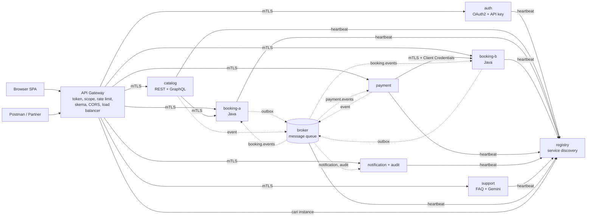

# Rangkai: Reservasi Kereta Antarkota

Sistem reservasi kereta dengan **seat locking per segmen**: satu kursi bisa dipakai beberapa penumpang pada ruas berbeda, misalnya Gambir-Yogyakarta dan Yogyakarta-Malang pada Gajayana. Data memakai 8 kereta KAI (Argo Bromo Anggrek, Taksaka, Gajayana, Matarmaja, Argo Parahyangan, Argo Wilis, Joglosemarkerto, Ambarawa Ekspres), 33 stasiun, kelas Ekonomi/Eksekutif/Luxury, dan 9 gerbong per rangkaian. Proyek lintas mata kuliah Web Service x Software Testing, **Kelompok A** (topik: sistem reservasi tiket transportasi).

## Akses cepat (deployment)

| Alamat | Isi |
|---|---|
| https://rangkai-production.up.railway.app | Aplikasi web |
| https://rangkai-production.up.railway.app/docs | Dokumen API interaktif (Swagger UI) |
| https://rangkai-production.up.railway.app/docs/openapi.yaml | Spesifikasi OpenAPI 3 |
| `POST https://rangkai-production.up.railway.app/graphql` | Endpoint GraphQL (skema: `GET /graphql/schema`) |
| https://rangkai-production.up.railway.app/healthz | Status layanan |

Database SQLite tiap service tersimpan di volume persisten, sehingga data tidak hilang saat layanan dimulai ulang.

## Anggota Kelompok A

| NRP | Nama | Web Service | Software Testing |
|---|---|---|---|
| 5803024004 | Jap Robertus Kurniawan Setiabudi | 27% | 27% |
| 5803024005 | Daniel | 27% | 27% |
| 5803024015 | Berliana Az Zahra Tristianti | 26% | 28% |
| 5803024003 | Calvin Liu Victory | 20% | tidak mengambil |
| 5803024016 | Evander Doxa Widiyanto | tidak mengambil | 18% |

Calvin hanya mengambil Web Service dan Evander hanya mengambil Software Testing.

Rincian tugas per orang dan per minggu (minggu 8 sampai UAS) ada di [docs/05-pembagian-tugas.md](docs/05-pembagian-tugas.md).

## Menjalankan secara lokal

Butuh **Node.js 22.13+** dan **JDK 21**. Semua perintah di bawah untuk Windows.

| Berkas | Fungsi |
|---|---|
| `run.bat` | Menyalakan seluruh sistem dan membuka browser |
| `stop.bat` | Menghentikan seluruh sistem |
| `test.bat` | Menu semua pengujian dan demo per minggu |

Saat pertama kali, `run.bat` memasang dependensi, membuat `.env` berisi secret acak, membuat sertifikat mTLS, dan membangun booking-service.

| Alamat | Isi |
|---|---|
| http://localhost:8080 | Aplikasi web |
| https://localhost:8443 | Aplikasi lewat TLS 1.2+ (sertifikat dev, akan muncul peringatan browser) |
| http://localhost:8080/docs | Dokumen API (Swagger UI) |
| `POST /graphql` | Endpoint GraphQL |

### Akun demo

Kata sandi semua akun demo: **`Rangkai2026!`** (hanya untuk lingkungan demo, diatur oleh `SEED_USER_PASSWORD`).

| Peran | Email | Bisa melakukan |
|---|---|---|
| Pelanggan | Daftar sendiri di halaman **Daftar** (tidak ada akun pelanggan bawaan) | Memesan, membayar, membatalkan |
| Masinis | `masinis@rangkai.test`, `masinis2@rangkai.test` | Jadwal dinas, manifest berbentuk denah kursi (kursi dari akun pemesan yang sama disorot), check-in tiket, lapor keterlambatan, notifikasi 60 menit sebelum dinas |
| Admin | `admin@rangkai.test` | Data operasional (stasiun, kereta, rute, tarif, jam, diskon lansia), pengguna, verifikasi transfer, armada, sistem, audit, API key. Tidak bisa memesan |

Stack `run.bat` hanya membuat akun admin dan masinis. Akun pelanggan demo (`customer@rangkai.test`, `customer2@rangkai.test`) dan riwayat pesanan rekaan hanya dibuat di stack pengujian `test.bat` (`SEED_DEMO_CUSTOMERS=1`, `SEED_DEMO_HISTORY=1`). Koleksi Postman mendaftarkan dua akun pelanggannya sendiri di folder "00 Persiapan".

Untuk menghapus akun pelanggan rekaan dan data uji (`@rangkai.test`, `@uji.rangkai`) dari database demo: `stop.bat`, lalu `node scripts/clean-demo-customers.js --dry-run` untuk melihat, dan tanpa `--dry-run` untuk menghapus. Akun yang didaftarkan sendiri, admin, dan masinis tidak tersentuh.

## Arsitektur



| Service | Port | Bahasa | Tanggung jawab |
|---|---|---|---|
| gateway | 8080, 8443 | Node | Satu pintu masuk: token, scope, rate limit, skema, CORS, load balancing, web, docs |
| registry | 8761 | Node | Service discovery berbasis heartbeat |
| broker | 8770 | Node | Message queue durable: routing topik, lease, retry, DLQ |
| auth | 8771 | Node | OAuth2 Authorization Server, JWT RS256, API key |
| catalog | 8772 | Node | Jadwal, formasi gerbong, REST + GraphQL |
| booking-a, booking-b | 8781, 8782 | Java 21 | Seat locking per segmen, pesanan, tiket |
| payment | 8773 | Node | Pembayaran, webhook bertanda tangan, refund |
| notification | 8774 | Node | Konsumen event: notifikasi, audit, peringatan |
| support | 8775 | Node | Pusat Bantuan: FAQ dan chat AI (Gemini, jatuh ke FAQ bila tidak tersedia) |

Rincian: [docs/03-arsitektur.md](docs/03-arsitektur.md). Pemetaan setiap ketentuan soal: [docs/00-checklist-ketentuan.md](docs/00-checklist-ketentuan.md).

## Daftar endpoint

Spesifikasi lengkap: [docs/openapi.yaml](docs/openapi.yaml) dan [docs/schema.graphql](docs/schema.graphql), contoh query di [docs/graphql-examples.md](docs/graphql-examples.md).

| Kelompok | Endpoint | Akses |
|---|---|---|
| OAuth2 | `GET /oauth/authorize`, `POST /oauth/login`, `POST /oauth/token`, `POST /oauth/revoke`, `GET /oauth/userinfo`, `GET /.well-known/*` | Publik / token |
| Akun | `POST /api/auth/register`, `GET`/`PATCH /api/auth/me`, `POST /api/auth/me/password` | Publik / token |
| Jadwal | `GET /api/stations`, `GET /api/trains`, `GET /api/pricing`, `GET /api/schedules?from&to&date&train`, `GET /api/trips/{id}`, `GET /api/trips/{id}/seats` | Publik |
| GraphQL | `POST /graphql`, `GET /graphql/schema` | Publik, mutation butuh scope |
| Kursi | `GET /api/trips/{id}/availability`, `GET /api/trips/{id}/seats/stream` (SSE) | Publik |
| Kursi | `POST /api/locks`, `GET /api/locks/{id}`, `PUT /api/locks/{id}` (ubah kursi dalam lock), `DELETE /api/locks/{id}` | `booking:*` |
| Pesanan | `POST /api/bookings`, `GET /api/bookings`, `GET /api/bookings/{id}`, `GET .../refund-preview`, `POST .../cancel` | `booking:*` |
| Pembayaran | `POST /api/payments`, `GET /api/payments?bookingId=`, `GET /api/payments/{id}`, `POST /api/payments/{id}/proof`, `GET /api/payments/proofs/{id}/file`, `POST /api/mock-gateway/checkout/{token}/pay` | `payment:write` / token |
| QRIS (ponsel) | `GET /api/qris/{token}`, `POST /api/qris/{token}/pay` | Publik, token checkout acak |
| Webhook | `POST /api/payments/webhook` | Tanda tangan HMAC |
| Notifikasi | `GET /api/notifications`, `GET /api/notifications/unread-count`, `POST /api/notifications/{id}/read`, `POST /api/notifications/read-all` | Token |
| Pusat Bantuan | `GET /api/support/faq`, `POST /api/support/chat` | Publik, dibatasi 12/menit |
| Masinis | `GET /api/masinis/trips`, `PATCH /api/masinis/trips/{id}/delay`, `GET /api/trips/{id}/manifest`, `POST /api/tickets/checkin` | Scope `masinis`, `manifest:read`, `checkin:write` |
| Jadwal (admin) | `POST /api/trips`, `PATCH /api/trips/{id}` | `schedule:write` |
| Partner | `GET /api/partner/v1/stations`, `.../schedules`, `.../trips/{id}/availability` | API key atau Client Credentials |
| Admin: pengguna | `/api/admin/users` (CRUD), `/api/admin/users/{id}/role`, `/api/admin/users/{id}/password` | `user:manage` |
| Admin: data operasional | `/api/admin/stations`, `/api/admin/trains` (CRUD), `/api/admin/trains/{id}/{route, fares, services}`, `/api/admin/trains/{id}/regenerate`, `/api/admin/settings` | `schedule:write` |
| Admin: transfer | `GET /api/admin/transfers`, `POST /api/admin/transfers/{proofId}/decision` | `payment:review` |
| Admin: armada dan sistem | `/api/admin/trains/{id}/trips`, `/api/admin/trips/{id}/passengers`, `/api/admin/trip-stats`, `/api/admin/catalog-stats`, `/api/admin/registry`, `/api/admin/queues`, `/api/admin/booking-stats`, `/api/admin/audit`, `/api/admin/alerts`, `/api/admin/api-keys` | `system:read`, `audit:read`, `apikey:manage` |

## Pembayaran (simulasi, tanpa uang sungguhan)

- **QRIS:** `POST /api/payments {bookingId, method: "QRIS"}` mengembalikan `instructions.qrisUrl`. Pindai QR dengan kamera atau Google Lens dari ponsel di Wi-Fi yang sama (gateway mendengar di `0.0.0.0`), lalu halaman ponsel membayar otomatis. Bila tidak bisa memindai, tombol simulasi memanggil `POST /api/mock-gateway/checkout/{token}/pay {outcome: "success" | "fail"}`. Status lunas selalu datang lewat webhook bertanda tangan HMAC, bukan dari browser.
- **QRIS dari jaringan mana pun:** Wi-Fi kampus atau publik sering memblokir koneksi antarperangkat, sehingga ponsel tidak bisa membuka alamat laptop. Jalankan `qris-tunnel.bat` (setelah `run.bat`): skrip membuka tautan publik sementara lewat localhost.run memakai `ssh` bawaan Windows, dan kode QR baru otomatis memakai alamat itu. Hanya halaman `/qris/...`, API `/api/qris/...`, dan aset tampilan yang bisa dibuka dari luar; rute lain dijawab 404. Tutup jendelanya untuk menutup tautan.
- **VA BCA/Mandiri:** pengguna mengunggah bukti transfer (JPG/PNG/WEBP/PDF, maks 3 MB) dan catatan. Admin menerima atau menolak dengan alasan. Penolakan masuk ke notifikasi, dan pengguna bisa mengunggah ulang dari Perjalanan Saya.
- **Penolakan transfer:** bila admin menolak bukti (termasuk mengubah keputusan dari diterima menjadi ditolak), pesanan tidak dibatalkan. Status kembali menunggu pembayaran, kursi tetap ditahan, tiket dicabut sementara, dan pengguna bisa mengunggah ulang bukti beserta catatan. Penerimaan berikutnya langsung mengonfirmasi pesanan.
- **Batas waktu:** QRIS mengikuti sisa penahanan kursi (10 menit). VA ditahan 2 jam, dan 24 jam setelah bukti diunggah (maksimal 1 jam sebelum berangkat).
- **Refund:** 90% (>= 72 jam sebelum berangkat), 75% (>= 24 jam), 50% (>= 3 jam), 0% (< 3 jam). Perjalanan dibatalkan admin: 100%.

## Pembaruan kursi real-time (SSE)

**Alur tahan kursi.** Begitu pelanggan menekan kursi, aplikasi langsung menguncinya di server (kursi pertama `POST /api/locks`, kursi berikutnya `PUT /api/locks/{id}`), dengan TTL 10 menit. Melepas pilihan atau meninggalkan halaman melepas kursinya. Semua perangkat lain yang membuka peta kursi yang sama melihat perubahan dalam hitungan detik. Status kursi di peta hanya empat: **Kosong**, **Pilihan Anda**, **Ditahan** (dikunci pengguna lain, tidak bisa ditekan), dan **Terisi**. Bila dua orang menekan kursi yang sama bersamaan, hanya satu yang berhasil (409 `SEAT_CONFLICT` untuk yang lain).

`GET /api/trips/{tripId}/seats/stream` (publik, tanpa data pribadi). Server mengirim `retry: 2000`, lalu event `seat` dengan `id: <seq>` dan data `{"seq":41,"seats":["EKS1-1A"],"fromIndex":0,"toIndex":3,"status":"LOCKED"}`. `status` bernilai `LOCKED`, `BOOKED`, atau `AVAILABLE`. Komentar `: detak` dikirim tiap 15 detik, dan koneksi ditutup setelah 15 menit. Klien mengambil ulang peta kursi setelah menerima event, menyambung ulang otomatis, dan polling tiap 8 detik selama terputus.

## Cara autentikasi

**Pengguna: Authorization Code + PKCE**

1. Buat `code_verifier` acak, lalu `code_challenge = BASE64URL(SHA256(code_verifier))`.
2. `GET /oauth/authorize?response_type=code&client_id=rangkai-postman&redirect_uri=http://localhost:8080/auth/callback&code_challenge=...&code_challenge_method=S256&state=...`
   dengan header `Accept: application/json`. Hasilnya `auth_request`.
3. `POST /oauth/login` berisi `{ auth_request, email, password }`. Hasilnya `code` sekali pakai.
4. `POST /oauth/token` (form) berisi `grant_type=authorization_code, client_id, code, code_verifier, redirect_uri`.
5. Kirim `Authorization: Bearer <access_token>`. Token berlaku 15 menit, perpanjang dengan `grant_type=refresh_token`. Refresh token berotasi, dan pemakaian ulang mencabut seluruh sesi.

Klien `rangkai-postman` mendaftarkan `{PUBLIC_URL}/auth/callback` (di deployment: `https://rangkai-production.up.railway.app/auth/callback`), `http://localhost:8080/auth/callback`, dan `https://oauth.pstmn.io/v1/callback`, jadi tab Authorization bawaan Postman bisa dipakai.

**Partner**: header `X-API-Key: rk_live_...` (dibuat admin), atau Client Credentials dengan `client_id=partner-demo` dan secret dari `.env`.

**Idempotency**: `POST /api/locks`, `POST /api/bookings`, `POST /api/payments` wajib membawa header `Idempotency-Key`.

## Pengujian

Jalankan `test.bat`, lalu pilih menu. Tiap pengujian yang butuh sistem berjalan memakai stack sendiri di port 9080 dengan database baru, sehingga hasilnya bisa diulang dan tidak mengganggu `run.bat`. Hasil tersimpan di folder `reports`.

| Berkas di `bat\` | Isi | Laporan |
|---|---|---|
| `week-08.bat` | Demo keamanan lanjutan | `reports/week-08.md` |
| `week-09.bat` | Demo API Gateway | `reports/week-09.md` |
| `week-10.bat` | Demo discovery, load balancing, failover (instance sungguhan dimatikan) | `reports/week-10.md` |
| `week-11.bat` | Demo message queue, DLQ, konsumen dan broker mati | `reports/week-11.md` |
| `test-junit.bat` | JUnit 5 dan JaCoCo | `services/booking/target/site/jacoco/index.html` |
| `test-node.bat` | Unit test Node | `reports/unit-node.txt` |
| `test-pytest.bat` | PyTest, EP dan BVA lewat API | `reports/pytest.html` |
| `test-postman.bat` | Koleksi Postman lewat Newman | `reports/postman.html` |
| `test-functional.bat` | Ujung ke ujung | `reports/functional-e2e.md` |
| `test-concurrency.bat` | Rebutan kursi lintas instance | `reports/concurrency.md` |
| `test-security.bat` | OWASP API Top 10 dan mTLS | `reports/security.md` |
| `test-load.bat` | Load test k6 | `reports/load-k6-summary.json` |
| `test-all.bat` | Semua di atas | `reports/SUMMARY.md` |

### Mengimpor ke Postman

1. Jalankan `run.bat` sekali. Berkas `postman/Rangkai.local.postman_environment.json` dibuat otomatis berisi secret lokal.
2. Di Postman: **Import**, pilih `postman/Rangkai.postman_collection.json` dan environment tadi.
3. Pilih environment **Rangkai (local)** di pojok kanan atas.
4. Jalankan folder **00 Persiapan** dulu, lalu folder lain per minggu. Atau klik kanan koleksi, **Run collection**.

Environment lokal berisi secret. Bagikan `Rangkai.template.postman_environment.json` kepada penguji, bukan berkas lokal. Untuk menguji deployment, isi `baseUrl` dengan `https://rangkai-production.up.railway.app`; secret partner/webhook diberikan langsung oleh Kelompok A kepada Kelompok B.

## Environment variable

Daftar lengkap ada di [.env.example](.env.example) dan [docs/04-environment-variables.md](docs/04-environment-variables.md). Isinya hanya placeholder.

## Struktur

```
services/   gateway, registry, broker, auth, catalog, booking (Java), payment, notification, support, shared
web/        aplikasi web, termasuk karakter Kiko
postman/    koleksi dan environment Postman
tests/      node (unit), pytest, functional, concurrency, security, load, weeks (demo per minggu)
docs/       openapi.yaml, schema.graphql, keamanan, arsitektur, test plan, progres, draf laporan
bat/        file bat per pengujian
```
