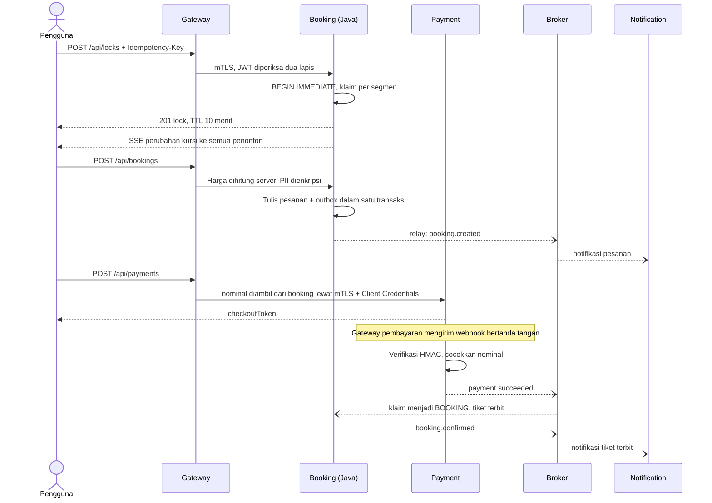

# Arsitektur Sistem

## Teknologi

| Lapisan | Teknologi | Alasan |
|---|---|---|
| Booking service | Java 21, HttpsServer JDK, virtual thread, SQLite JDBC | Logika konkurensi paling kritis, dan bisa diuji JUnit sesuai anjuran soal |
| Service lain | Node.js 24, Express 5, `node:sqlite` | Ringan dan cepat dikembangkan |
| Web | HTML, CSS, JavaScript modul, tanpa framework | Tanpa langkah build, mudah dijalankan penguji |
| GraphQL | Pustaka referensi `graphql` | Implementasi resmi |
| JWT | `jose` di Node, verifikasi RS256 sendiri di Java | Pustaka teruji, tidak mengarang kriptografi |
| Pengujian | JUnit 5, JaCoCo, node:test, PyTest, Newman, k6 | Sesuai materi kuliah |

Polyglot ini disengaja: tiap service independen dan hanya berkomunikasi lewat HTTP + mTLS atau antrian.

## Model data seat locking

Rute Arunika punya 9 stasiun, jadi 8 segmen (0 sampai 7).

```
Stasiun  : SGU --0-- MR --1-- JG --2-- KTS --3-- NJ --4-- MN --5-- NGW --6-- SLO --7-- YK
Sinta    : [=================================== 0..4 ==============]
Bima     :                                                          [===== 5..7 ======]
```

Ruas dinyatakan sebagai rentang `[from, to)`. Dua rentang tumpang tindih bila `a.from < b.to && b.from < a.to`, sehingga berbagi stasiun Madiun bukan konflik.

```sql
seat_claims(trip_id, seat_id, segment_idx, owner_type, owner_id, expires_at,
            PRIMARY KEY (trip_id, seat_id, segment_idx))
```

## Alur pesan



## Antrian

| Topik | Antrian | Konsumen |
|---|---|---|
| `payment.succeeded`, `payment.failed`, `trip.cancelled` | `booking.events` | booking-service, salah satu instance |
| `payment.refund_required`, `booking.cancelled` | `payment.events` | payment-service |
| `booking.*`, `payment.*`, `seat.lock.expired`, `trip.*`, `test.*` | `notification.events` | notification-service |
| `audit.*`, `security.*` | `audit.events` | notification-service |

Broker dibuat sendiri dan durable (SQLite), agar `run.bat` bisa langsung jalan tanpa Docker. Semantiknya mengikuti work queue AMQP: routing topik, at-least-once, lease, ack/nack, retry dengan backoff, DLQ, deduplikasi. Konsumen idempotent lewat tabel `processed_messages`. Berpindah ke RabbitMQ hanya mengubah `services/shared/bus.js` dan `Workers.java`.

## Discovery dan load balancing

Tiap instance mendaftar ke registry dan mengirim heartbeat tiap 4 detik. Instance yang diam lebih dari 12 detik dikeluarkan. Gateway memakai round robin dari daftar yang di-cache 2 detik, melewati instance yang baru gagal selama 5 detik, dan mencoba instance lain bila koneksi gagal. Identitas pendaftar dicocokkan dengan CN sertifikat, sehingga service tidak bisa menyamar.

Booking-service stateless di memori: semua keadaan ada di database bersama, jadi instance mana pun bisa melayani permintaan apa pun. SSE tetap konsisten karena tiap instance membaca tabel `seat_events`.

## Prinsip UI dan interaksi manusia komputer

| Heuristik Nielsen | Penerapan |
|---|---|
| Visibilitas status sistem | Langkah pemesanan, hitung mundur yang selalu terlihat, indikator "Langsung" pada peta kursi, kerangka saat memuat |
| Kesesuaian dengan dunia nyata | Karcis berlubang, papan keberangkatan, pintu gerbong, istilah kursi dan ruas |
| Kendali dan kebebasan pengguna | Tombol lepas kursi, batal, kembali, pilihan kursi tersimpan saat diminta masuk |
| Konsistensi | Permukaan yang bisa ditindaklanjuti selalu berupa karcis gading di latar gelap |
| Pencegahan kesalahan | Validasi langsung, NIK dicek saat diketik, konfirmasi sebelum tindakan permanen, pratinjau refund sebelum membatalkan |
| Pengenalan, bukan mengingat | Daftar stasiun bisa dicari, legenda kursi selalu terlihat, ringkasan pesanan selalu tampil |
| Fleksibilitas | Navigasi panah pada peta kursi, Enter pada formulir, tukar asal dan tujuan |
| Minimalis | Satu tombol utama per layar, data lengkap hanya di konsol |
| Pemulihan dari kesalahan | Pesan dalam bahasa manusia dengan langkah berikutnya, kursi yang diambil orang lain langsung diberi tahu |
| Bantuan | Kiko memberi arahan pendek sesuai konteks |

Aksesibilitas: fokus keyboard terlihat, `aria-live` untuk status, tautan lewati navigasi, dan `prefers-reduced-motion` dihormati.
