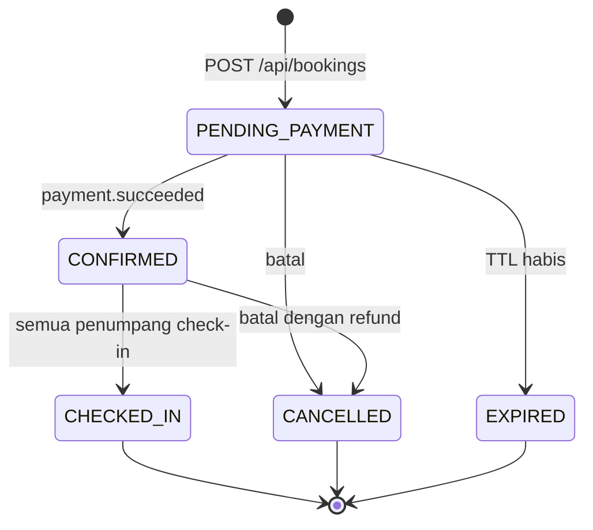

# Test Case Design

Test otomatis ada di `tests/` dan `services/booking/src/test`. Tabel ini menjelaskan cara nilai uji dipilih, untuk bagian 5.2 laporan.

## Equivalence Partitioning dan Boundary Value Analysis

### Jumlah kursi per pesanan (batas 1 sampai 4)

| Nilai | Kelas | Hasil diharapkan | Test |
|---|---|---|---|
| 0 | Tidak valid, bawah | 422 | `test_seat_count_boundaries`, `invalidSeatLists` |
| 1 | Batas bawah | 201 | sama |
| 4 | Batas atas | 201 | sama |
| 5 | Tidak valid, atas | 422 | sama |

### Usia penumpang

| Nilai | Golongan | Tarif | Test |
|---|---|---|---|
| -1 | Tidak valid | Ditolak | `outOfRangeAgeThrows` |
| 0, 2 | Bayi | Ditolak, tidak perlu kursi | `ageBoundaries`, `test_age_and_nik_decision_table` |
| 3, 11 | Anak | 75% | `test_fare_by_age_boundaries` |
| 12, 59 | Dewasa | 100% | sama |
| 60, 120 | Lansia | 80% | sama |
| 121 | Tidak valid | Ditolak | `outOfRangeAgeThrows` |

### NIK

| Nilai | Kelas | Hasil |
|---|---|---|
| 16 digit, format benar | Valid | Diterima |
| 15 digit, 17 digit | Panjang salah | `INVALID_NIK` |
| Provinsi 10, 97 | Batas provinsi | `INVALID_NIK` |
| Tanggal 32, 40, 72 | Batas tanggal (perempuan +40) | `INVALID_NIK` |
| Tanggal 71 | Batas atas perempuan | Diterima |
| Bulan 00, 13 | Batas bulan | `INVALID_NIK` |

### TTL lock

| Permintaan | Hasil |
|---|---|
| 2 detik | Ditolak, di bawah minimum |
| 3 detik | Diterima, batas bawah |
| 600 detik | Diterima, batas server |
| 3600 detik | Diterima tetapi dipotong ke 600 |

### Refund menurut sisa waktu

| Sisa waktu | Persentase |
|---|---|
| Tepat 72 jam | 90% |
| 72 jam kurang 1 ms | 75% |
| Tepat 24 jam | 75% |
| 24 jam kurang 1 ms | 50% |
| Tepat 3 jam | 50% |
| 3 jam kurang 1 ms | 0% |
| 0 atau sudah lewat | Ditolak |

### Kata sandi

| Panjang atau isi | Hasil |
|---|---|
| 7 karakter | Ditolak |
| 8 karakter, huruf dan angka | Diterima |
| 72 karakter | Diterima |
| 73 karakter | Ditolak |
| Tanpa angka, tanpa huruf | Ditolak |

## Decision table: usia dan NIK

| Usia 17+ | NIK diisi | NIK benar | Hasil |
|---|---|---|---|
| Ya | Tidak | - | `NIK_REQUIRED` |
| Ya | Ya | Tidak | `INVALID_NIK` |
| Ya | Ya | Ya | Diterima |
| Tidak | Tidak | - | Diterima |
| Tidak | Ya | Tidak | `INVALID_NIK` |
| Tidak | Ya | Ya | Diterima |

## Decision table: tumpang tindih segmen

Lock pertama: Surabaya ke Madiun, segmen `[0,5)`.

| Lock kedua | Rentang | Tumpang tindih | Hasil |
|---|---|---|---|
| Madiun ke Yogyakarta | `[5,8)` | Tidak, batas tepat | 201 |
| Ngawi ke Solo | `[6,7)` | Tidak | 201 |
| Nganjuk ke Madiun | `[4,5)` | Ya, segmen terakhir | 409 |
| Surabaya ke Mojokerto | `[0,1)` | Ya, segmen pertama | 409 |
| Jombang ke Ngawi | `[2,6)` | Ya, melewati batas | 409 |
| Surabaya ke Madiun | `[0,5)` | Ya, sama persis | 409 |

## State transition: status pesanan

Semua transisi lain ditolak dengan 409. Diuji oleh `transitions` di `DomainRulesTest` dan F-25, F-28, S-32.

## Skenario konkurensi

| ID | Skenario | Invarian |
|---|---|---|
| K-01 | 50 pengguna merebut kursi dan ruas yang sama | Tepat satu 201, sisanya 409, tanpa 5xx |
| K-02 | Delapan ruas acak pada satu kursi | Lock yang diterima tidak tumpang tindih |
| K-03 | Delapan ruas berurutan | Semua berhasil |
| K-04 | Empat pengguna, kursi saling beririsan | Tidak ada klaim setengah jalan |
| K-05 | Satu Idempotency-Key dikirim 20 kali bersamaan | Satu lock |
| K-06 | 240 percobaan acak | Nol pelanggaran |
| K-07 | 20 pengguna merebut tepat saat TTL habis | Tepat satu pemenang |
| K-08 | Pembayaran dan webhook ganda | Satu pembayaran, satu tiket |

## Skenario negatif keamanan

Lihat `tests/security/run.js`. S-01 sampai S-54 dipetakan ke OWASP API Top 10: API1 BOLA, API2 autentikasi, API3 properti objek, API4 konsumsi sumber daya, API5 fungsi, API8 miskonfigurasi.

## Test case manual antarmuka

| ID | Langkah | Hasil diharapkan |
|---|---|---|
| U-01 | Buka beranda dalam mode lebar dan ponsel | Tidak ada gulir horizontal, formulir terbaca |
| U-02 | Tekan Tab berulang dari awal halaman | Fokus terlihat dan urut, semua kontrol terjangkau |
| U-03 | Tekan Kiko sekali, dua kali cepat, tahan, geser | Ekspresi berubah: kesal, berputar, geli, menggelepar |
| U-04 | Tekan Kiko lima kali beruntun | Peluit bunyi dan kereta melintas |
| U-05 | Buka peta kursi di dua jendela. Tahan kursi di jendela pertama | Jendela kedua berubah kurang dari 1 detik tanpa muat ulang |
| U-06 | Pilih kursi di jendela A, lalu tahan kursi itu di jendela B | Jendela A memberi tahu dan melepas pilihan |
| U-07 | Pilih kursi tanpa masuk, lalu tekan Tahan | Diarahkan masuk, pilihan tersimpan setelah kembali |
| U-08 | Ketik NIK salah | Pesan langsung muncul, formulir tidak terkirim |
| U-09 | Biarkan hitung mundur habis | Dialog menjelaskan, kursi dilepas, ada jalan kembali |
| U-10 | Aktifkan kurangi gerakan di sistem operasi | Animasi berhenti, fungsi tetap berjalan |
| U-11 | Fokus kolom kata sandi | Kiko menutup mata |
| U-12 | Bandingkan warna teks dan latar | Kontras memenuhi WCAG AA pada teks utama |

## Skenario SUS untuk usability

Minta 5 orang menyelesaikan tugas: "Pesan dua kursi Surabaya ke Madiun untuk besok, lalu batalkan." Catat waktu, kesalahan, dan skor System Usability Scale.
